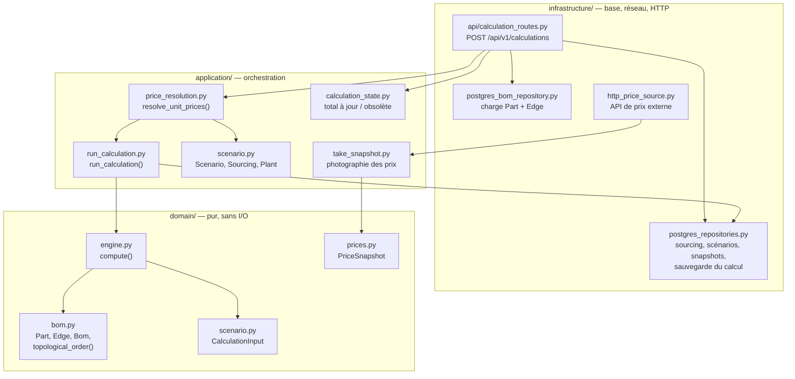
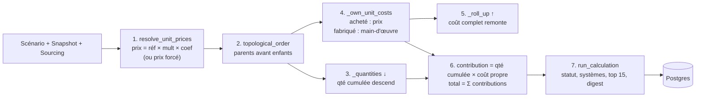

# Analyse du périmètre « calcul du coût et du carbone »

> Document d'analyse, rédigé à partir du code au commit `00420ac`.
> Il décrit **ce que fait le code aujourd'hui**, pas ce que disent les ADR qu'il
> devrait faire ; les écarts entre les deux sont listés en §5 et §6.

---

## 1. En une phrase

Le calcul prend une **nomenclature en graphe (DAG)**, un **snapshot de prix** et
un **scénario** (taux horaire, fournisseurs, usines, prix forcés), résout le prix
unitaire de chaque pièce achetée, puis parcourt le graphe **une seule fois par
pièce** pour produire le coût total d'une Multipla, sa décomposition par système
et ses principaux contributeurs.

**Le coût est calculé. Le carbone ne l'est pas** : les données existent (facteur
carbone par pièce, CO₂ de transport par usine, colonnes en base), mais aucune
ligne de code ne les multiplie.

---

## 2. Architecture

Trois couches, dépendances vers l'intérieur uniquement (ADR-0004, vérifié par
`backend/tests/test_layer_dependencies.py`).



### Rôle de chaque fichier

| Fichier | Rôle dans le calcul |
|---|---|
| `domain/bom.py` | `Part` (réf., système, mode `purchased`/`manufactured`, `labour_minutes`, `mass_kg`, `carbon_factor`), `Edge` (parent → enfant, quantité), `Bom` + tri topologique qui **détecte les cycles**. |
| `domain/prices.py` | `PriceSnapshot` daté et immuable ; statut `FRESH` / `STALE` (> 24 h) / `DEGRADED` (repli ou prix manquant). |
| `domain/scenario.py` | `CalculationInput` : BOM + prix unitaires **déjà résolus** + taux horaire + règles actives. |
| `domain/engine.py` | **Le moteur.** Quantités cumulées, coût propre, coût complet, total. |
| `application/scenario.py` | Ce que règle l'utilisateur : `Scenario`, `ScenarioParameter` (portée pièce/chemin), catalogue `Sourcing` (offres fournisseur, usines). |
| `application/price_resolution.py` | Prix unitaire = référence × multiplicateur fournisseur × coefficient usine, ou prix forcé justifié. Rejette les paramètres inapplicables. |
| `application/run_calculation.py` | Appelle le moteur, puis ajoute : statut, totaux par système, top contributeurs, empreinte (`input_digest`) pour la reproductibilité. |
| `application/calculation_state.py` | Compare l'empreinte courante à celle du dernier calcul → `UP_TO_DATE` / `PARAMETERS_CHANGED` (et pourquoi : prix ou paramètres). |
| `infrastructure/api/calculation_routes.py` | Routes scénario, paramètre, calcul, vue agrégée. Assemble les étapes ci-dessus. |
| `infrastructure/postgres_repositories.py` | Lit sourcing/scénarios/snapshots, écrit `calculation`, `calculation_line`, `calculation_system_total`. |
| `backend/migrations/0001_initial_schema.sql` | Contraintes qui rendent la double comptabilisation impossible (acheté xor fabriqué), colonnes CO₂ prévues. |

---

## 3. Entrées et sorties

### Entrées

| Entrée | Source | Contenu utile au calcul |
|---|---|---|
| Nomenclature | Postgres (`part`, `bom_edge`) | 474 pièces, 689 arêtes, 65 pièces à parents multiples |
| Snapshot de prix | Postgres, alimenté par l'API externe | prix de référence par pièce achetée, pièces en repli, pièces manquantes |
| Sourcing | Postgres (`supplier`, `supplier_plant`, `part_supplier`) | multiplicateur fournisseur, coefficient usine, CO₂ transport/kg, délai |
| Scénario | Corps de `POST /scenarios` + paramètres | taux horaire, devise d'affichage, règles actives (`labour`), paramètres par pièce |

### Sortie (`Calculation`)

- `total_cost` — somme des `own_contribution` (exacte, `Decimal`, échelle 6) ;
- `status` — `OK` / `DEGRADED` (prix de repli ou périmés) / `INCOMPLETE` (au moins un prix manquant, pièces nommées) ;
- `lines` — une ligne **par pièce** : quantité cumulée, nombre d'occurrences, coût unitaire propre, contribution propre, coût unitaire complet ;
- `systems` — coût et part (%) par système (moteur, caisse…) ;
- `top_contributors` — les 15 plus grosses contributions propres, avec un chemin pour déplier l'arbre jusqu'à elles ;
- `explanations` — décomposition du prix de chaque pièce achetée (référence, fournisseur, usine, pays, justification d'un prix forcé) ;
- `input_digest`, `engine_version`, `rules_version`, `snapshot_id` — de quoi rejouer le calcul.

---

## 4. Le calcul du coût, pas à pas



1. **Résolution du prix** (`price_resolution.py`) — pour chaque pièce *achetée* :
   prix forcé s'il existe (justification obligatoire), sinon
   `référence × multiplicateur_fournisseur × coefficient_usine`, arrondi une
   fois à 6 décimales. Fournisseur/usine par défaut si le scénario n'en choisit
   pas. Pas de prix de référence → pièce **manquante**, jamais zéro.
2. **Ordre topologique** (`bom.py`) — algorithme de Kahn ; lève une erreur s'il
   reste des pièces non atteintes (cycle).
3. **Quantités cumulées** (descente) — la racine vaut 1 ; chaque enfant reçoit
   `qté_parent × qté_arête`, **additionnée sur tous ses parents**. C'est ce qui
   fait qu'une vis M6 présente sous le moteur *et* sous la caisse est comptée
   pour sa quantité réelle.
4. **Coût propre unitaire** — pièce achetée : son prix. Pièce fabriquée :
   `minutes / 60 × taux_horaire` si la règle `labour` est active, sinon 0.
   Jamais les deux (ADR-0008).
5. **Coût complet** (remontée, ordre inverse) — `propre + Σ qté × complet(enfant)`.
   Un enfant sans prix rend tous ses ancêtres `None` (« incalculable » plutôt que
   « faussement bon marché »). Sert à l'affichage d'une ligne d'arbre ; **ne se
   somme pas**.
6. **Total** — `Σ qté_cumulée × coût_propre` sur toutes les pièces. Chaque pièce
   est évaluée une seule fois : complexité O(pièces + arêtes).
7. **Habillage** (`run_calculation.py`) — statut, totaux par système, top 15,
   empreinte SHA-256 des entrées.

**Invariant clé** : `Σ own_contribution == total_cost` au centime près (et au
millionième), parce qu'on n'arrondit qu'à l'affichage (ADR-0011).

---

## 5. Le calcul du carbone : état réel

### Ce qui était prévu (`docs/perimetre.md`, `docs/api.md`)

« Même parcours, mêmes quantités cumulées » que le coût :

```
CO₂ propre (pièce achetée) = carbon_factor_kg_co2e_per_unit
                           + mass_kg × transport_co2_kg_per_kg (usine retenue)
CO₂ total                  = Σ qté_cumulée × CO₂ propre
```

Périmètre annoncé (cadrage, A10) : extraction → sortie d'usine, transport
fournisseur inclus ; usage et fin de vie exclus.

### Ce qui existe

| Élément | État |
|---|---|
| `Part.carbon_factor`, `Part.mass_kg` | ✅ chargés depuis la base |
| `Plant.transport_co2_kg_per_kg` | ✅ chargé dans le sourcing |
| Colonnes `calculation.total_co2`, `calculation_line.own_co2_contribution`, `calculation_system_total.co2` / `co2_share_pct` | ✅ présentes dans le schéma |
| Calcul dans `engine.py` | ❌ absent |
| Champs CO₂ dans `PartLine`, `Calculation`, `SystemTotal` | ❌ absents |
| Sortie API (`total_co2`, `rolled_up_co2`, `top_co2_contributors`) | ❌ absente alors que `docs/api.md` la documente |
| Écran | ❌ rien |

---

## 6. Ce qui fonctionne mal

Classés du plus grave au moins grave. Chaque point a été vérifié dans le code ;
aucun n'a été reproduit contre une base réelle pendant cette analyse.

1. **Le CO₂ est écrit à zéro en base.**
   `postgres_repositories.py` (COPY `calculation_system_total`) insère
   `Decimal(0)` pour `co2` et `co2_share_pct`. Un zéro se lit « ce système
   n'émet rien » — exactement ce que la règle « un manquant n'est jamais un
   zéro » interdit pour les prix. `total_co2` et `own_co2_contribution` restent
   `NULL`, ce qui est au moins honnête ; le zéro ne l'est pas.

2. **Le paramètre `labour_minutes` d'un scénario est ignoré par le moteur.**
   L'API l'accepte, le valide (refusé sur une pièce achetée), le persiste et
   l'inclut dans `input_digest` — mais `engine._own_unit_costs` lit
   `part.labour_minutes` (la nomenclature), jamais le paramètre. Conséquence :
   l'utilisateur change un temps, l'écran marque le total « obsolète »,
   il recalcule, **le total ne bouge pas**. Aucun message ne le signale.

3. **Les règles actives ne sont pas validées.** `active_rules` accepte n'importe
   quelle chaîne. Une faute de frappe (`"labor"`) désactive silencieusement la
   main-d'œuvre. La règle `supplier_multiplier` décrite dans
   `docs/perimetre.md` n'existe pas : le multiplicateur est toujours appliqué.

4. **Portée « chemin » ignorée en silence.** `Scenario.parameter_for` ne retient
   que la portée `part` ; un paramètre de portée `path` est persisté et entre
   dans l'empreinte, mais n'a aucun effet sur le résultat. Choix documenté
   (mieux vaut ne rien appliquer que tout appliquer), mais le calcul ne le
   signale pas dans ses hypothèses.

5. **`price_status` ne distingue pas un prix de repli.** La ligne vaut `"OK"` ou
   `"MISSING"` ; `"FALLBACK"` (documenté dans `api.md`) n'est jamais produit,
   alors que `snapshot.fallback_refs` porte l'information.

6. **Unité codée en dur.** `calculation_line.unit` est toujours écrit `"pce"`,
   alors que `Part.unit` existe (des pièces peuvent être en kg ou en litres).

7. **Devise d'affichage sans conversion.** `display_currency` est stocké et
   renvoyé, mais aucun taux n'est appliqué : un scénario en USD afficherait des
   montants en euros étiquetés USD. (Le README dit que seul l'euro est servi ;
   rien dans le code ne refuse USD/RUB.)

8. **Pièce fabriquée sans temps de main-d'œuvre = 0 €** sans avertissement.
   Probablement voulu (un sous-ensemble logique), mais indiscernable d'un temps
   oublié dans les données.

---

## 7. Ce qu'il manque / reste à faire

Repris du README (§ « Ce qu'il reste à faire ») et complété par cette analyse.

- **Empreinte carbone** (T2) — tout le §5.
- **Rendre la quarantaine visible** (route `GET /price-snapshots/{id}/quarantine`, statut de repli par ligne).
- **Devises USD / RUB.**
- **Portée « chemin »** — la clé de mémoïsation du moteur doit porter un contexte (ADR-0002).
- **Prix forcé et temps de main-d'œuvre éditables à l'écran** — et, pour le temps, d'abord le faire prendre en compte par le moteur (§6.2).
- **Route `/explain`** : la décomposition du prix n'est pas relue après redémarrage.
- **T3 — comparer deux fournisseurs** en € *et* en kg CO₂e (dépend du carbone).

---

## 8. Liste des modifications à faire

Par ordre recommandé. Chaque point suit la règle du dépôt : test qui échoue
d'abord, puis le code.

| # | Modification | Fichiers | Test à écrire d'abord |
|---|---|---|---|
| 1 | Cesser d'écrire `0` dans `calculation_system_total.co2` : écrire `NULL` (rendre la colonne nullable par migration) tant que le carbone n'est pas calculé | `postgres_repositories.py`, nouvelle migration `0002` | intégration : un calcul sauvé n'a aucun CO₂ à zéro |
| 2 | Appliquer `ScenarioParameter.labour_minutes` : passer au moteur une table `labour_minutes` résolue par l'application (comme les prix) | `domain/scenario.py`, `domain/engine.py`, `application/run_calculation.py` | moteur : un temps surchargé change la contribution de la pièce et le total |
| 3 | Valider `active_rules` contre la liste connue, 422 sinon | `calculation_routes.py` | API : `["labor"]` → 422 |
| 4 | **Carbone dans le moteur** : `CalculationInput.unit_co2` (résolu dans l'application : `carbon_factor + mass_kg × transport_co2_kg_per_kg`), `PartLine.own_co2_contribution` / `full_unit_co2`, `CalculationResult.total_co2` ; même descente de quantités, même remontée. Pièce sans masse → CO₂ transport **manquant**, nommé | `engine.py`, `price_resolution.py` (ou `carbon_resolution.py`), `bom.py` | moteur : sur le DAG de test, `Σ own_co2 == total_co2` ; pièce partagée comptée une fois par occurrence ; changer d'usine change le CO₂ |
| 5 | Carbone dans l'habillage : `SystemTotal.co2`, `co2_share_pct`, `top_co2_contributors` | `run_calculation.py` | application : somme des CO₂ par système == total CO₂ |
| 6 | Persister et relire le CO₂ (`total_co2`, `own_co2_contribution`, `co2` système) | `postgres_repositories.py` | intégration sur vrai Postgres |
| 7 | Exposer le CO₂ dans l'API au format de `docs/api.md` (`{"kg_co2e": "…"}` en chaîne) | `calculation_routes.py`, `app.py` | API : champ présent, chaîne, pas de flottant |
| 8 | Afficher CO₂ dans la synthèse et l'arbre (formatage uniquement, dans `format.ts`) | `frontend/src` | test front sur le formatage |
| 9 | Produire `price_status = "FALLBACK"` pour les pièces de `snapshot.fallback_refs` | `postgres_repositories.py`, `run_calculation.py` | ligne en repli → `FALLBACK` |
| 10 | Écrire `Part.unit` au lieu de `"pce"` | `postgres_repositories.py` | intégration |
| 11 | Refuser une `display_currency` ≠ EUR tant que la conversion n'existe pas | `calculation_routes.py` | API : `USD` → 422 explicite |
| 12 | Lister dans les hypothèses du calcul les paramètres ignorés (portée chemin) | `run_calculation.py` | application |
| 13 | Implémenter ou retirer de `perimetre.md` la règle `supplier_multiplier` | à décider | — |

### Décisions métier à prendre avant le point 4

Le dépôt demande de ne pas les inventer ; les voici exposées avec une proposition :

- **Pièce achetée sans `mass_kg`** : proposition — CO₂ transport *manquant*, calcul carbone `INCOMPLETE`, pièce nommée (même règle que les prix).
- **Pièce fabriquée** : a-t-elle un CO₂ propre (énergie d'assemblage) ? Proposition — 0 en v1, **écrit dans les hypothèses du calcul**, comme la règle `labour`.
- **Le CO₂ transport dépend-il du prix forcé ?** Proposition — non : un prix forcé garde l'usine par défaut pour le CO₂.
- **Statut du calcul** : un coût complet mais un carbone incomplet donne-t-il `INCOMPLETE` global ou deux statuts ? Proposition — deux statuts séparés (`cost_status`, `co2_status`).

Ces quatre réponses devraient faire l'objet d'un **ADR-0012** avant d'écrire le code.
