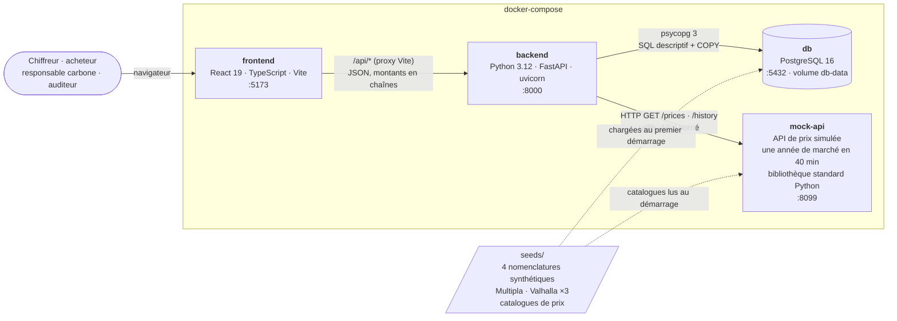
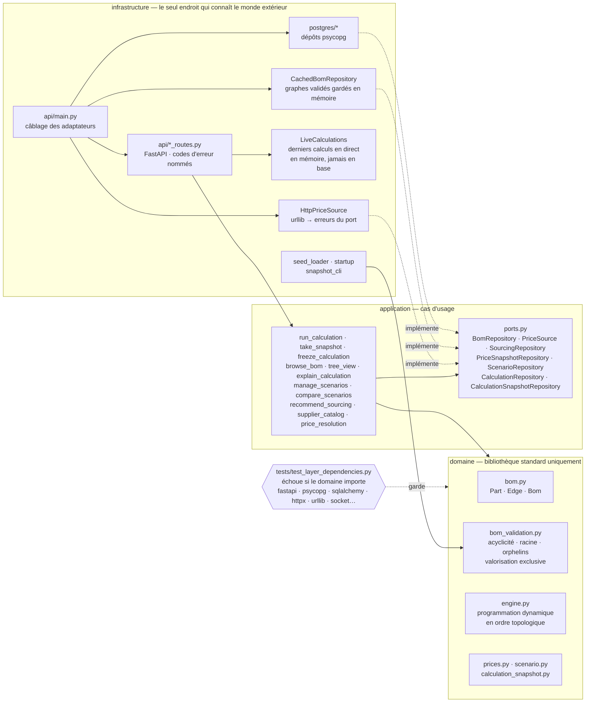
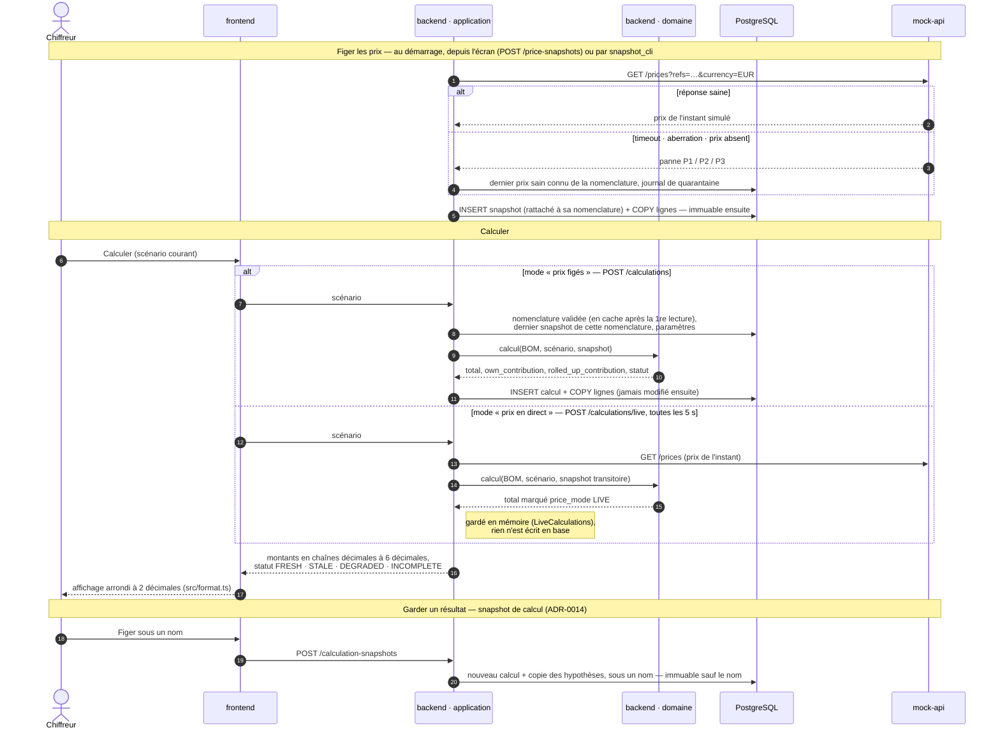

# Architecture — 3istor

- **Date** : 2026-10-02 — à jour de la PR #7 (plusieurs nomenclatures, prix en direct, snapshots de
  calcul : [ADR-0014](adr/0014-snapshot-de-calcul-nomme.md),
  [ADR-0015](adr/0015-plusieurs-nomenclatures-et-prix-en-direct.md))
- **Statut** : descriptif — ce document décrit ce qui tourne, il ne décide rien. Les décisions sont
  dans les [ADR](adr/README.md) ; en cas de désaccord, c'est l'ADR et le code qui font foi.
- **Lire avant** : [domain-glossary.md](domain-glossary.md) §1, [cadrage.md](cadrage.md) §3 à §5.

Ce document a deux parties : **ce qu'il y a** (les schémas) et **pourquoi cette pile** (la
justification des choix techniques au regard du besoin métier).

---

## 1. Vue d'ensemble : les conteneurs

Quatre services, lancés par `docker-compose up` à la racine du dépôt.

| Service | Rôle | Ce qu'il ne fait **pas** |
|---|---|---|
| `frontend` | Choisir une nomenclature, déplier nœud par nœud, saisir des paramètres, basculer prix figés / en direct, formater | Additionner, multiplier, arrondir pour calculer (règle « aucune arithmétique métier dans le navigateur ») |
| `backend` | Valider les nomenclatures, prendre les snapshots de prix, calculer, expliquer, enregistrer, figer des snapshots de calcul | Faire confiance à l'API de prix ; enregistrer un calcul en direct |
| `db` | Stocker les graphes, les snapshots, les scénarios, les calculs ; **refuser** les écritures interdites | Contenir une règle métier (ADR-0007) |
| `mock-api` | Jouer l'API externe : des prix qui **bougent** (neuf indices synthétiques rejoués sur une année), leur historique, et des pannes **à la demande** (en-tête `X-Mock-Failure`) | Faire partie du produit : c'est un banc d'essai |

Au démarrage, le backend applique les migrations manquantes puis, **pour chaque nomenclature** de
`seeds/`, la charge si elle manque et lui prend son premier snapshot de prix s'il n'en a aucun
(`infrastructure/startup.py`). Une nomenclature non validée ou un premier snapshot impossible
bloque le démarrage avec un diagnostic, sans rien écraser.

Les quatre nomenclatures n'ont pas la même forme : le Multipla (474 pièces, 689 arêtes) est un
**DAG** à pièces partagées ; les trois Valhalla importées (535 à 659 pièces) sont des **arbres**
(une arête de moins que de pièces). Le moteur ne fait aucune différence : un arbre est un DAG
particulier.

---

## 2. Le backend : trois couches, une seule direction

Les flèches d'import vont **vers le domaine**, jamais dans l'autre sens
([ADR-0004](adr/0004-trois-couches-et-regle-de-dependance.md)). Le domaine est une fonction pure
`(nomenclature, scénario, snapshot) → résultat` : il se teste en millisecondes sur une fixture en
mémoire, sans base ni réseau. Le câblage est explicite dans `infrastructure/api/main.py`, sans
conteneur d'injection.

Le calcul en direct n'a pas de moteur à lui : il construit un snapshot de prix **transitoire** et
appelle le même `run_calculation` que le calcul figé (ADR-0015). Seul l'endroit où le résultat est
gardé change — `LiveCalculations`, en mémoire, borné à 64 calculs.

---

## 3. Un calcul, de bout en bout

Ce que ce schéma rend visible :

- **Deux façons de lire les prix, un seul calcul.** En mode figé, le calcul lit un snapshot en base :
  une API tombée ne peut pas le faire échouer, seulement le rendre `DEGRADED` ou `STALE`
  ([ADR-0003](adr/0003-snapshot-de-prix-persiste-et-immuable.md)). En mode direct, il interroge
  l'API à chaque rafraîchissement, et c'est pour cela que **rien n'en est enregistré** : un total
  qu'on ne peut pas rejouer n'a pas d'identifiant durable. Pour garder un chiffre, on fige d'abord
  les prix ([ADR-0015](adr/0015-plusieurs-nomenclatures-et-prix-en-direct.md)).
- **Un snapshot de prix appartient à une nomenclature.** On ne valorise jamais une Valhalla avec les
  prix du Multipla ; le repli d'une panne se fait sur le dernier prix connu **de cette
  nomenclature**, dans la même devise.
- **Un calcul figé est enregistré tel quel.** Mêmes entrées, même snapshot ⇒ même résultat ; et
  l'enregistrement ne se modifie plus (invariant I5). Le snapshot de calcul va plus loin : il copie
  les hypothèses, et se relit sans le scénario vivant qui continue de bouger.
- **Les chiffres changent de forme une seule fois**, à l'écran
  ([ADR-0011](adr/0011-decimal-exact-et-arrondi-a-l-affichage.md)).

---

## 4. Ce que la base garantit seule

Certaines règles ne sont pas confiées au code applicatif, parce qu'un bug, un script ou une session
`psql` pourrait les contourner. La base les refuse elle-même (`backend/migrations/`) :

| Garantie | Mécanisme | Invariant |
|---|---|---|
| Une pièce achetée n'a pas d'enfant ; une pièce fabriquée n'a pas de prix | Clés étrangères composites sur `(ref, valuation_mode)` | I2 |
| Une paire parent-enfant est unique | Clé primaire de `bom_edge` | I3 |
| Un snapshot de prix, ses lignes et un calcul ne se modifient pas | Déclencheurs `price_snapshot_immutable`, `calculation_no_update` | I5 |
| Une nomenclature validée est gelée | Déclencheurs `*_frozen_once_validated` ([ADR-0013](adr/0013-version-de-nomenclature-validee-immuable.md)) | I5 |
| Un snapshot de calcul ne change que de nom, et ne se supprime pas ; ses paramètres copiés ne bougent pas | Déclencheurs `calculation_snapshot_*` ([ADR-0014](adr/0014-snapshot-de-calcul-nomme.md)) | I5 |
| Les montants sont exacts | Domaines `numeric(18, 6)` — jamais de `float` | I1 |
| Le tri des références est le même sur toutes les machines | `initdb --locale=C` | I5 |

La CI vérifie que ces refus tiennent : le script `migrations/checks/contraintes.sql` doit compter
exactement **26** écritures interdites refusées.

---

## 5. Pourquoi cette pile

La pile a été **choisie par l'équipe**, pas imposée. Ce choix n'a pas fait l'objet d'un ADR au
moment où il a été pris ; cette section l'écrit **après coup**. Elle justifie donc une décision
déjà en place, et le dit — elle ne prétend pas retracer une délibération qui n'a pas été écrite.

Le fil conducteur : le besoin n'est **pas** un CRUD. Le cadrage dit que l'outil sera jugé sur trois
choses — la justesse des quantités sur un graphe, la traçabilité de chaque euro, l'honnêteté quand
les prix sont dégradés ([cadrage.md](cadrage.md) §1). Chaque brique est retenue pour ce qu'elle
apporte à l'une de ces trois exigences.

### 5.1 Du besoin à la brique

| Exigence métier | Ce qu'elle demande techniquement | Brique qui y répond |
|---|---|---|
| Un total juste « au centime », dont les lignes somment exactement au total (I1) | Arithmétique décimale exacte de bout en bout, arrondi à l'affichage seulement | `decimal.Decimal` (Python) · `numeric` (Postgres) · montants en chaînes dans le JSON |
| Une nomenclature qui est un DAG, pas un arbre (I3, I4) | Un moteur de graphe **testé avant d'être écrit**, sur des fixtures en losange | Python + pytest, domaine sans dépendance |
| Rejouer un calcul trois mois plus tard (I5) | Des snapshots et des calculs persistés, datés, **impossibles à modifier** | PostgreSQL : transactions, déclencheurs, contraintes |
| Refuser une nomenclature incohérente plutôt que la digérer (I2, I3) | Des contraintes que même un import fautif ne peut pas violer | PostgreSQL : clés étrangères composites, unicité |
| Survivre à une API de prix qui tombe (P1, P2, P3) | Un client au délai borné, des pannes reproductibles à la demande | `urllib` derrière un port · simulateur piloté par en-tête · Docker Compose |
| Voir les prix bouger sans perdre la reproductibilité | Un mode direct qui calcule sans rien enregistrer, et un geste explicite pour figer | Même moteur, snapshot transitoire, cache mémoire borné · rafraîchissement par l'écran |
| Expliquer jusqu'à la vis, sans charger tout le graphe à l'écran | Un dépliage nœud par nœud, une interface à état riche | React + TypeScript |
| Un contrat d'API qui ne laisse pas passer un `float` ni confondre deux montants | Des types partagés en lecture entre écran et API | TypeScript (`api/types.ts`) · FastAPI (schéma OpenAPI) |
| Une équipe de quatre, deux soutenances, un jury qui lance le projet | Peu de briques, un seul langage côté serveur, une commande pour tout lancer | Python partout côté serveur · `docker-compose up` |

### 5.2 Python 3.12 pour le domaine et le serveur

**Ce qui l'a fait retenir**
- **`Decimal` est dans la bibliothèque standard**, avec `ROUND_HALF_UP`. L'invariant I1 tient sans
  dépendance : le domaine entier (`domain/`, ~920 lignes) n'importe que des modules standard —
  `dataclasses`, `decimal`, `enum`, `typing`, `collections`, `datetime`, `unicodedata`.
- **Un seul langage pour tout ce qui calcule ou fabrique des données** : le moteur, le générateur de
  nomenclature (`tools/bom_generator`), l'import des Valhalla (`tools/valhalla_import`), le chargeur,
  le simulateur de prix. Une règle de validation écrite une fois sert à la génération, à l'import et
  au calcul.
- **`dataclass(frozen=True)`** donne des entités immuables sans bibliothèque — la forme naturelle
  d'un snapshot ou d'une ligne de calcul qui ne doivent pas bouger.
- **pytest** rend le test-d'abord peu coûteux, ce qui est la façon de travailler exigée sur toute
  logique de domaine ([AGENTS.md](../../AGENTS.md)).

**Ce qu'il coûte**
- Le typage n'est pas vérifié à l'exécution ni en CI (pas de `mypy`) : il documente, il ne protège
  pas.
- Python est lent en calcul pur. Sans conséquence ici : au plus ~660 pièces par nomenclature, un
  calcul linéaire en ordre topologique
  ([ADR-0005](adr/0005-calcul-par-programmation-dynamique-en-ordre-topologique.md)), y compris
  refait toutes les 5 s en mode direct. Le seuil de réouverture est fixé à 2 s de recalcul
  ([perimetre.md](perimetre.md)).

**Alternatives qu'on aurait pu prendre**
- *Node / TypeScript côté serveur* — un seul langage sur toute la pile, séduisant. Mais pas de
  décimal exact natif : il aurait fallu une bibliothèque (`decimal.js`, `big.js`) au cœur du moteur,
  et chaque opérateur `+` oublié serait un flottant silencieux.
- *Java / Kotlin* — `BigDecimal` et un typage fort, mais un coût de démarrage et de cérémonie
  disproportionné pour quatre personnes sur quelques semaines.

### 5.3 FastAPI pour l'API

**Ce qui l'a fait retenir**
- **Léger et sans opinion sur la persistance.** FastAPI ne pousse pas vers un modèle ORM : il laisse
  le domaine au centre, ce que l'ADR-0004 exige.
- **Des gestionnaires d'exception** traduisent les exceptions métier en codes nommés
  (`BOM_VERSION_NOT_VALIDATED`, `PARAMETER_NOT_APPLICABLE`…) en un seul point (`api/app.py`), comme
  le contrat de [api.md](api.md) §1.5 le demande.
- **Un schéma OpenAPI généré** sert de contrôle croisé avec le contrat écrit.
- **Le client de test** (`TestClient`) teste les routes sans lancer de serveur.

**Ce qu'il coûte**
- Les routes sont synchrones et servies depuis un pool de threads ; il a fallu des verrous sur les
  deux caches en mémoire (`CachedBomRepository`, `LiveCalculations`).

**Alternatives qu'on aurait pu prendre**
- *Django + DRF* — l'administration gratuite est tentante, mais tout Django est organisé autour de
  ses modèles ORM : c'est exactement l'option B que l'ADR-0004 a écartée (moteur intestable sans
  base).
- *Flask* — aussi léger, mais sans validation ni documentation de schéma intégrées ; on les aurait
  ajoutées à la main.

### 5.4 PostgreSQL 16, sans ORM

**Ce qui l'a fait retenir**
- **Le graphe est relationnel.** Une table d'arêtes (`part`, `bom_edge`) est la représentation que
  l'[ADR-0001](adr/0001-bom-en-table-d-aretes.md) a retenue ; une base relationnelle la porte sans
  détour, et sait servir les lectures ensemblistes de l'écran — enfants directs, *where-used*,
  recherche — paginées et indexées ([ADR-0007](adr/0007-sql-lit-le-graphe-le-code-calcule.md)).
  Plusieurs nomenclatures cohabitent dans les mêmes tables, distinguées par `bom_version_id`.
- **La base fait respecter les invariants qui ne doivent pas dépendre du code** (§4) : valorisation
  exclusive par clés étrangères composites, immuabilité des snapshots, des calculs et des
  nomenclatures validées par déclencheurs. C'est la réponse technique à « d'où sort ce chiffre ? ».
- **`numeric` exact** : la base ne réintroduit pas d'erreur d'arrondi entre deux calculs.
- **`COPY`** charge les nomenclatures et enregistre les lignes de calcul d'un bloc, au lieu d'une
  boucle d'`INSERT`.

**Pourquoi psycopg sans ORM.** Les requêtes sont volontairement **descriptives** — filtrer, joindre,
compter, paginer — et peu nombreuses. Un ORM aurait ajouté un second modèle de données à côté des
entités du domaine, et rendu plus facile de faire passer un objet ORM dans le domaine « juste cette
fois ». Le mapping est écrit à la main, et reste petit.

> L'ADR-0004 cite SQLAlchemy comme bibliothèque d'infrastructure. Le code ne l'utilise pas : la
> persistance passe directement par psycopg 3. Le test d'architecture interdit quand même son import
> dans le domaine, ce qui reste juste.

**Ce qu'il coûte**
- Un conteneur à faire tourner, même en développement ; les tests d'intégration en dépendent, et la
  CI refuse qu'ils soient sautés.
- Le mapping manuel entités ↔ lignes SQL, à maintenir.

**Alternatives qu'on aurait pu prendre**
- *Une base orientée graphe (Neo4j)* — la plus séduisante sur le papier pour un DAG. Écartée parce que
  le calcul ne se fait pas en base de toute façon (ADR-0007), que les garanties dont le projet a le
  plus besoin — contraintes d'intégrité, immuabilité, transactions sur un snapshot entier — sont le
  terrain des bases relationnelles, et qu'elle ajoutait un langage de requête de plus.
- *Une base documents (MongoDB)* — imbriquer les sous-ensembles dans leur parent, c'est modéliser un
  **arbre** : la vis partagée y serait dupliquée, exactement l'erreur que l'outil existe pour éviter.
  Et pas de clé étrangère pour refuser une nomenclature incohérente.
- *SQLite* — suffisant en volume, plus simple à lancer. Mais pas de domaines `numeric` exacts (SQLite
  stocke les décimaux en flottant ou en texte), et des déclencheurs moins expressifs.

### 5.5 React 19 + TypeScript + Vite pour l'écran

**Ce qui l'a fait retenir**
- **L'écran principal est un arbre à état** : chaque nœud se déplie à la demande, une pièce partagée
  apparaît à plusieurs endroits avec un badge, le panneau de saisie suit la sélection, le clavier
  navigue dans l'arbre ([ADR-0009](adr/0009-depliage-paresseux-du-dag-a-l-ecran.md)). C'est le cas
  d'usage pour lequel un modèle à composants récursifs (`TreeNode`) et un état d'arbre isolé
  (`tree/useTreeState.ts`) sont faits.
- **TypeScript rend le contrat d'API visible dans l'éditeur.** Les montants y sont typés `string` :
  `a.amount + b.amount` concatène au lieu d'additionner, et l'erreur saute aux yeux à l'écran au lieu
  de produire un total plausible et faux.
- **Deux dépendances d'exécution seulement** (`react`, `react-dom`) : pas de gestionnaire d'état, pas
  de routeur, pas de bibliothèque de composants ni de graphiques — la courbe de prix d'une pièce
  (`PriceChart`) est un SVG écrit à la main.
- **Vite** sert l'écran en développement et **proxifie `/api`** vers le backend : pas de CORS à
  configurer, des URL relatives dans le code. **Vitest + Testing Library** testent les composants dans
  le même outillage.

**Ce qu'il coûte**
- L'écran est servi par le serveur de développement Vite, y compris dans Docker : il n'y a pas de
  build de production servi par un serveur statique.
- Le mode direct et la courbe de prix se rafraîchissent par **interrogation toutes les 5 s**
  (`setInterval`), pas par un canal poussé (WebSocket, SSE) : plus simple, au prix d'un appel à
  l'API de prix par écran ouvert et par période.

**Alternatives qu'on aurait pu prendre**
- *Rendu serveur (gabarits Jinja, HTMX)* — moins de code et un seul langage. Mais le dépliage, la
  sélection et le panneau de saisie auraient fait un aller-retour serveur à chaque clic, et l'état de
  l'arbre déplié aurait vécu côté serveur.
- *Vue ou Svelte* — techniquement équivalents pour ce besoin ; React a été retenu sur la familiarité
  de l'équipe.

### 5.6 Docker Compose et un simulateur de prix maison

**Ce qui l'a fait retenir**
- **Une seule commande** lance les quatre services avec leurs sondes de santé, dans l'ordre
  (`db` et `mock-api` sains → `backend` → `frontend`). Le jury n'installe ni Python ni Node.
- **Le simulateur est un service réseau à part**, comme le serait la vraie API. Un timeout y est un
  vrai timeout réseau, pas une exception levée par un double de test.
- **Les pannes se déclenchent par en-tête** (`X-Mock-Failure: timeout | outlier | missing | garbage`),
  jamais au hasard : une démonstration doit être reproductible.
- **Les prix bougent de façon déterministe** : neuf indices synthétiques (métaux, semi-conducteurs,
  énergie, transport, change GBP→EUR) ont une valeur par jour sur une année, rejouée en 40 minutes.
  À instant égal, prix égaux ; `--year-minutes 0` fige les prix. Le simulateur expose aussi
  `/history`, l'année jour par jour, pour la courbe d'une pièce.
- Le simulateur n'utilise que la bibliothèque standard (`http.server`) et le client `urllib` :
  un simulateur ne mérite pas une dépendance, et un appel synchrone avec un délai suffit.

**Ce qu'il coûte**
- Le volume `db-data` survit aux relancements : un changement de seeds ne se voit qu'après
  `docker-compose down -v`, qui détruit aussi les calculs enregistrés.
- Sous Windows, Docker passe par WSL, avec ses pièges (voir le [README](../../README.md)).

---

## 6. Ce que cette architecture ne couvre pas

Ce sont des limites assumées, pas des oublis ; chacune a son déclencheur.

| Limite | Pourquoi c'est acceptable aujourd'hui | Ce qui ferait changer |
|---|---|---|
| Mono-utilisateur, sans authentification | Hypothèse A8 du [cadrage](cadrage.md) §6 | Plusieurs utilisateurs, ou un prix forcé à attribuer à quelqu'un |
| Recalcul complet à chaque calcul, sans incrémental | Au plus ~660 pièces : le recalcul est rapide (ADR-0007) | Recalcul au-delà de 2 s sur la plus grosse nomenclature |
| Prise de snapshot de prix à la main (écran ou `snapshot_cli`), jamais planifiée | Voir [ADR README](adr/README.md), « ce qui reste à décider » | Utilisateur en `STALE` permanent |
| Un calcul en direct n'est ni enregistré, ni comparable, et un redémarrage l'oublie | Voulu : il n'est pas rejouable (ADR-0015) ; pour le garder, on fige les prix | Un besoin d'historiser les prix vus en direct |
| Mode direct par interrogation toutes les 5 s | Quelques écrans ouverts, une API simulée locale | Une vraie API de prix facturée ou limitée en débit |
| Une seule source de prix, sans conteneur d'injection | Un seul adaptateur réel par port (ADR-0004) | Un deuxième adaptateur réel d'un même port |
| Écran servi par Vite en mode développement | Démonstration locale uniquement | Un déploiement réel |
