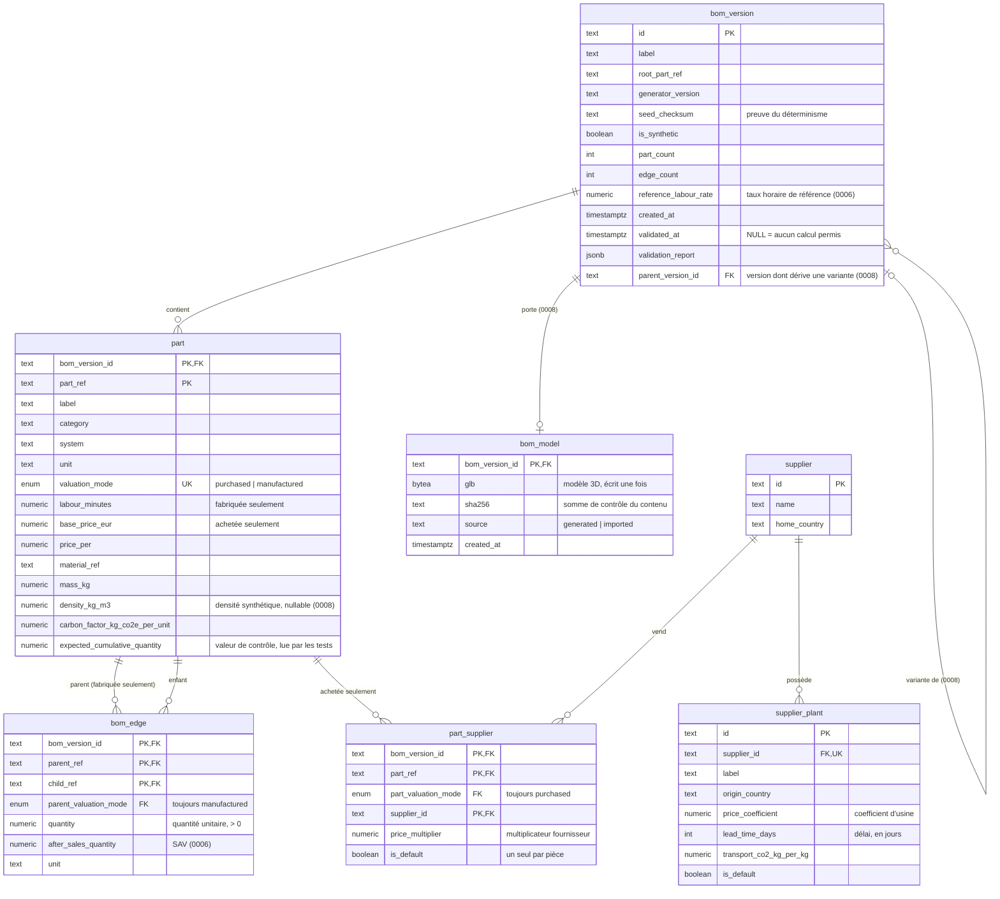
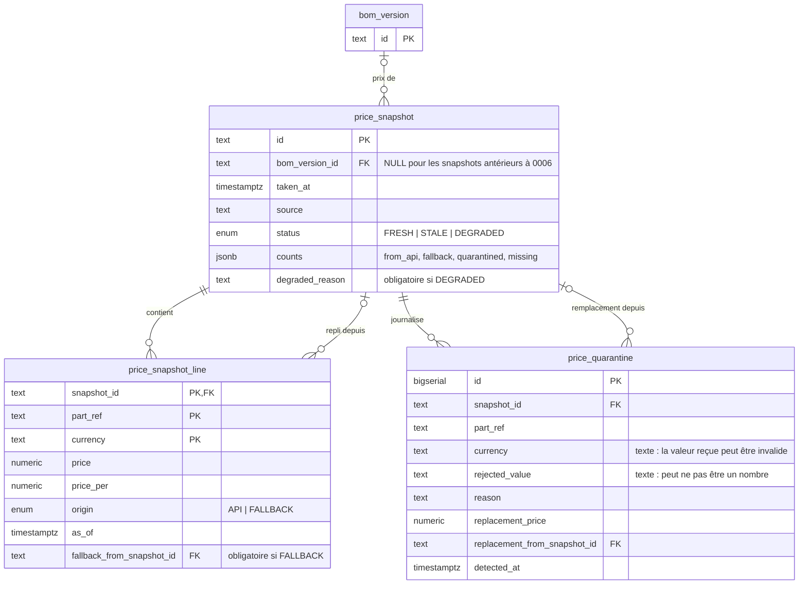
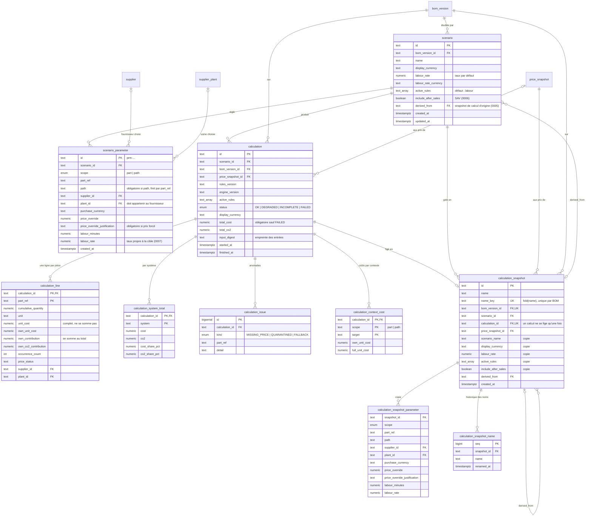

# Schéma de la base — 3istor

Le schéma PostgreSQL tel que le produisent les migrations `0001` à `0007`
([backend/migrations/](../backend/migrations/)). La source de vérité reste le SQL : si ce document et une
migration divergent, c'est la migration qui a raison, et ce document qu'il faut corriger.

Trois diagrammes, un par zone, plutôt qu'un seul illisible. Les tables qui reviennent d'un diagramme à
l'autre (`bom_version`, `supplier`, `price_snapshot`…) n'y portent que leur clé.

Conventions : `PK` clé primaire, `FK` clé étrangère, `UK` unicité. Les montants sont en
`numeric(18, 6)`, sans arrondi en base (ADR-0011).

---

## 1. Nomenclature et sourcing

Le graphe est une **table d'arêtes** (ADR-0001) : une pièce = une ligne, quel que soit le nombre de ses
parents. Les nomenclatures (Multipla, trois Valhalla) cohabitent, distinguées par `bom_version_id`.

**Ce que la base garantit ici**

- **Valorisation exclusive** (ADR-0008) : quatre `CHECK` sur `part` (achetée ⇒ prix et pas de temps ;
  fabriquée ⇒ temps et pas de prix). La colonne `parent_valuation_mode` de `bom_edge`, fixée à
  `manufactured` et reliée à `part` par une clé composite `(bom_version_id, part_ref, valuation_mode)`,
  interdit à une pièce achetée d'avoir des enfants. `part_supplier` utilise le même mécanisme pour
  interdire un fournisseur sur un ensemble fabriqué.
- **Arêtes** : une seule arête par paire (parent, enfant), pas de boucle sur soi-même, quantité > 0.
- **Version validée figée** (ADR-0013, migration 0003) : dès que `validated_at` est renseigné, des
  déclencheurs refusent toute écriture sur `part`, `bom_edge`, `part_supplier` et `bom_version`.
- **Modèle 3D** (ADR-0017, migration 0008) : `bom_model` porte au plus un modèle par version ; il
  s'écrit une fois (`forbid_mutation` : ni `UPDATE`, ni `DELETE`) et se rattache même à une version
  validée, car il ne touche ni `part`, ni `bom_edge`, ni `part_supplier`. La base vérifie que
  `sha256` est celui du contenu (intégrité, pas une règle métier) et que `source` vaut `generated`
  ou `imported`. `part.density_kg_m3` est nullable et strictement positive ; `parent_version_id` doit
  désigner une version existante, autre que la version elle-même. Les densités sont synthétiques et
  la migration n'en remplit aucune.
- **Ce qu'elle ne garantit pas** : l'acyclicité, l'absence d'orphelin et l'unicité de la racine. Le
  chargeur les vérifie par tri topologique avant de renseigner `validated_at`.

Index utiles : `bom_edge (bom_version_id, child_ref)` pour le where-used ; trigramme sur `part.label`
pour la recherche.

---

## 2. Prix

Un snapshot de prix est une photographie **immuable** des prix d'une nomenclature (ADR-0003, ADR-0015).

- `price_snapshot` et `price_snapshot_line` : déclencheurs `forbid_mutation`, donc **ni UPDATE ni
  DELETE**.
- `price_snapshot_line.part_ref` ne porte **pas** de clé étrangère vers `part` : le lien passe par
  `price_snapshot.bom_version_id`.
- Les calculs « prix en direct » utilisent un snapshot transitoire **jamais écrit** dans ces tables.

---

## 3. Scénarios, calculs et snapshots de calcul

**Ce que la base garantit ici**

- **Un paramètre par cible** : index unique `(scenario_id, part_ref, coalesce(path, ''))`. Une pièce peut
  donc avoir un paramètre de portée `part` **et** des paramètres de portée `path`.
- **Usine cohérente avec le fournisseur** (ADR-0010) : clé composite `(plant_id, supplier_id)` vers
  `supplier_plant (id, supplier_id)`.
- **Prix forcé justifié** : `CHECK` sur la justification non vide.
- **Calcul non modifiable** (I5) : un déclencheur refuse tout `UPDATE`. La suppression reste possible, pour
  que supprimer un scénario supprime en cascade ses paramètres et ses calculs.
- **Snapshot de calcul** (ADR-0014) : seul le nom peut changer (déclencheur qui compare la ligne entière
  sans `name` et `name_key`) ; suppression interdite ; copie des paramètres et historique des noms en
  ajout seul. Aucune de ses clés étrangères n'est en cascade : un scénario qui porte un snapshot de calcul
  ne peut pas être supprimé (`409 SCENARIO_HAS_SNAPSHOTS`).
- `scenario_parameter.part_ref`, `calculation_line.part_ref` et `calculation_issue.part_ref` ne portent
  **pas** de clé étrangère vers `part` : la cohérence avec la nomenclature est contrôlée par
  l'application (`PARAMETER_NOT_APPLICABLE`).

---

## 4. Récapitulatif de l'immuabilité

| Table | INSERT | UPDATE | DELETE | Mécanisme |
|---|---|---|---|---|
| `part`, `bom_edge`, `part_supplier` | refusé si BOM validée | refusé si BOM validée | refusé si BOM validée | `forbid_change_to_validated_bom` (0003) |
| `bom_version` | oui | refusé si validée | refusé si validée | `forbid_change_to_validated_bom_version` (0003) |
| `bom_model` | oui (même sur version validée) | **non** | **non** | `forbid_mutation` (0008) |
| `price_snapshot`, `price_snapshot_line` | oui | **non** | **non** | `forbid_mutation` (0001) |
| `calculation` | oui | **non** | oui (cascade du scénario) | `forbid_mutation` (0001) |
| `calculation_snapshot` | oui | nom seul | **non** | 0004 |
| `calculation_snapshot_parameter`, `calculation_snapshot_name` | oui | **non** | **non** | `forbid_mutation` (0004) |

Le script [checks/contraintes.sql](../backend/migrations/checks/contraintes.sql) tente les 32 écritures
interdites et vérifie qu'elles sont toutes refusées ; la CI échoue si ce nombre change.

## 5. Types et domaines

| Nom | Définition |
|---|---|
| `valuation_mode` | `purchased`, `manufactured` |
| `parameter_scope` | `part`, `path` |
| `price_snapshot_status` | `FRESH`, `STALE`, `DEGRADED` |
| `price_line_origin` | `API`, `FALLBACK` |
| `calculation_status` | `OK`, `DEGRADED`, `INCOMPLETE`, `FAILED` |
| `calculation_issue_kind` | `MISSING_PRICE`, `QUARANTINED`, `FALLBACK` |
| `money_amount`, `quantity_value`, `co2_kg` | `numeric(18, 6)` |
| `coefficient` | `numeric(12, 6)` |
| `part_reference` | texte `^[A-Z0-9-]+$` (transportable dans une URL sans échappement) |
| `currency_code` / `country_code` | trois / deux lettres majuscules |

La table technique `schema_migration` enregistre les migrations appliquées.
